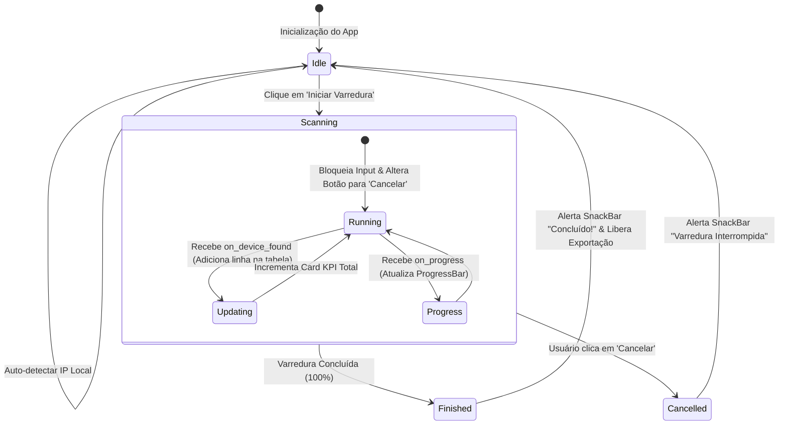

# FRONTEND_SPEC — Especificação de Interface e Design do Usuário
## Bot de Varredura e Inventário Control iD (Flet Desktop)

Este documento especifica a arquitetura visual, hierarquia de componentes, estados de interação, tokens de design e gerenciamento de estado da interface gráfica desktop construída com **Flet**.

---

### 1. Visão Geral da Interface e Diretrizes de Design

- **Framework:** [Flet](https://flet.dev) (Baseado na engine do Flutter).
- **Paradigma Visual:** Material Design 3 (Fluent/Modern Desktop).
- **Tema Padrão:** Dark Mode corporativo (alto contraste, reduz fadiga visual).
- **Dimensões da Janela:**
  - Largura Padrão: `1050px` (mínima: `850px`).
  - Altura Padrão: `720px` (mínima: `600px`).
  - Redimensionável: Sim.
  - Janela Centralizada na abertura.

---

### 2. Árvore de Componentes (Component Tree)

```text
frontend/app.py (View Container Principal - Padding 24px)
│
├── Header (components/header.py)
│   ├── Logo / Ícone de Rede ("Radar / Devices")
│   ├── Título Principal: "Control iD — Scanner de Rede"
│   └── Badge / Chip: "Interface Ativa: 192.168.1.100 (Ethernet)"
│
├── ControlsBar (components/controls.py)
│   ├── TextField: "Faixa de Rede / CIDR" (ex: 192.168.1.0/24)
│   ├── ElevatedButton: "Auto-detectar" (Ícone: Autorenew)
│   └── ElevatedButton: "Iniciar Varredura" (Cor: Azul/Verde, Ícone: Play / Stop)
│
├── KPICards (components/kpi_cards.py) - Grid / Row com 3 Cards
│   ├── Card 1 (Destaque): "Dispositivos Encontrados" (Contador grande verde)
│   ├── Card 2: "IPs Escaneados" (ex: 145 / 254)
│   └── Card 3: "Tempo Decorrido" (ex: 00:14s)
│
├── ClientForm (components/client_form.py) - Cabeçalho Manual
│   ├── TextField: Cliente / Empresa
│   ├── Row de Endereço: Rua, Número, Bairro
│   ├── Row Técnico & Local: Técnico Responsável, Local do Equipamento
│   └── ElevatedButton: "Gerar Documento Interno (PDF)"
│
├── ProgressBarSection (Integrado em app.py / controls.py)
│   ├── ProgressBar (0.0 a 1.0 com animação suave)
│   └── Text: "Escaneando 192.168.1.55..." (status do host corrente)
│
├── DeviceTableSection (components/device_table.py)
│   ├── Container com Scroll Vertical e Borda arredondada
│   └── DataTable:
│       ├── Coluna 1: IP Local (Texto em negrito monoespaçado)
│       ├── Coluna 2: MAC Address (Formatado AA:BB:CC:DD:EE:FF)
│       ├── Coluna 3: Número de Série (Badge / Texto destacado)
│       ├── Coluna 4: Modelo (Tag colorida: iDFace, iDClass, etc.)
│       ├── Coluna 5: Firmware (Versão do sistema)
│       └── Coluna 6: Latência (ms)
│
└── FooterActions (app.py)
    ├── Botão: "Exportar CSV" (Ícone: FileDownload)
    ├── Botão: "Exportar JSON" (Ícone: Code)
    └── Botão: "Abrir Pasta de Relatórios" (Ícone: FolderOpen)
```

---

### 3. Tokens de Cores e Estilos (`frontend/styles/theme.py`)

| Token | Valor Hex / Flet Color | Finalidade |
| :--- | :--- | :--- |
| **`COLOR_BG_DARK`** | `#121824` | Fundo principal da janela |
| **`COLOR_SURFACE`** | `#1B2436` | Superfície dos cards e containers |
| **`COLOR_BORDER`** | `#2B3854` | Bordas e divisores sutis |
| **`COLOR_PRIMARY`** | `#2563EB` | Azul de ação (botão Iniciar, abas ativas) |
| **`COLOR_SUCCESS`** | `#10B981` | Verde de destaque para equipamentos encontrados |
| **`COLOR_WARNING`** | `#F59E0B` | Amarelo para alertas ou timeouts |
| **`COLOR_TEXT_PRIMARY`** | `#F8FAFC` | Texto de alto contraste |
| **`COLOR_TEXT_MUTED`** | `#94A3B8` | Textos secundários, labels e descrições |

---

### 4. Ciclo de Vida e Estados da Interface (UX State Machine)



#### Descrição dos Estados:
1. **`Idle` (Ocioso / Pronto):**
   - Campo de sub-rede preenchido com a rede detectada automaticamente.
   - Botão "Iniciar Varredura" ativo (azul).
   - Tabela exibe mensagem: *"Nenhuma varredura iniciada. Clique em 'Iniciar Varredura' para buscar equipamentos Control iD."*
   - Botões de exportação desabilitados.
2. **`Scanning` (Em Execução):**
   - Campo de sub-rede desabilitado.
   - Botão principal muda para "Cancelar" (vermelho).
   - Barra de progresso visível e ativa.
   - Dispositivos surgem em tempo real na tabela (streaming reativo).
   - Indicador de latência e IP atual em atualização contínua.
3. **`Finished` (Concluído):**
   - Barra de progresso em 100%.
   - Notificação tipo toast (`SnackBar`) exibindo: *"Varredura concluída! X dispositivos Control iD encontrados."*
   - Botões "Exportar CSV" e "Exportar JSON" são ativados.
4. **`Empty State` (Nenhum Dispositivo):**
   - Caso nenhum host responda aos endpoints da Control iD, um alerta amigável é exibido: *"Nenhum equipamento Control iD encontrado na sub-rede informada. Verifique se os dispositivos estão ligados e na mesma VLAN."*

---

### 5. Especificação dos Componentes Modulares

#### 5.1. `header.py`
```python
def create_header(local_ip: str, interface_name: str) -> ft.Row:
    """Renderiza a barra superior com título, ícone e badge com informações da placa de rede."""
```

#### 5.2. `controls.py`
```python
def create_controls_bar(
    on_start_scan: Callable,
    on_auto_detect: Callable,
    is_scanning: bool = False
) -> ft.Container:
    """Barra horizontal com campo de IP/CIDR, botão Auto-detectar e botão Iniciar/Cancelar."""
```

#### 5.3. `kpi_cards.py`
```python
def create_kpi_cards(
    total_found: int = 0,
    scanned_count: int = 0,
    total_hosts: int = 254,
    elapsed_time: float = 0.0
) -> ft.Row:
    """Conjunto de cards com estatísticas em tempo real, destacando o total de equipamentos."""
```

#### 5.4. `device_table.py`
```python
def create_device_table(devices: list[ControlIdDevice]) -> ft.Container:
    """Tabela de alta legibilidade renderizando os dados coletados com tags de modelo coloridas."""
```

---

### 6. Tratamento de Notificações e Feedback Visual
- **SnackBar de Sucesso:** Fundo verde escuro informando a conclusão ou gravação do arquivo de relatório em disco.
- **SnackBar de Erro:** Fundo vermelho alertando formato de IP/CIDR inválido.
- **Abertura de Pasta:** Acionamento de `os.startfile(reports_dir)` no Windows ao clicar em "Abrir Pasta de Relatórios".
